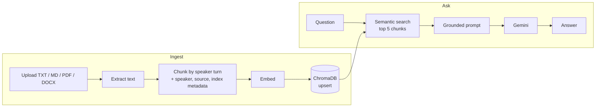

# MeetingMind AI

**Ask questions across your meeting transcripts and documents in plain English, and get answers grounded only in what was actually said.**

A Retrieval-Augmented Generation (RAG) app built with ChromaDB, Gemini and Streamlit, whose chunking follows who is speaking.

> **Status: v1, complete.** Upload, index and chat all work end to end.

---

## How it works



1. **Ingest:** text is extracted from the uploaded file (`pypdf` for PDF, `python-docx` for DOCX, plain reads for TXT and MD).
2. **Speaker-aware chunking:** transcripts are split at every change of speaker, not at a fixed character count, so each chunk keeps *who said what*. Regex patterns cover the common formats:
   - `Name:`
   - `Name (MM:SS):`
   - `[Name]`
   - `Speaker 1:`
3. **Store:** chunks are embedded and upserted into a persistent ChromaDB collection, with metadata (speaker, source file, chunk index).
4. **Ask:** your question is embedded, the 5 most similar chunks are retrieved, and they're passed to Gemini with their sources.
5. **Grounded answer:** the prompt instructs the model not to invent information and to answer only from the retrieved chunks. Questions the transcripts can't answer are declined instead of guessed.

## Features

- **Speaker-turn chunking:** keeps speaker context intact, which fixed-size chunking breaks.
- **Grounded answers:** generation is restricted to retrieved context, to limit hallucination.
- **Idempotent ingestion:** chunk IDs are deterministic (`{source}_{chunk_index}`) and written with `upsert`, so re-uploading a file updates it instead of creating duplicates.
- **Persistent index:** ChromaDB stores everything on disk in `database/`, so documents survive restarts.
- **Chat UI:** a Streamlit interface with session-based chat history.

## Quickstart

### Prerequisites
- Python 3.10+
- A Gemini API key ([get one here](https://aistudio.google.com/apikey))

### Install
```bash
git clone https://github.com/huzefaarab/MeetingMindAI.git
cd MeetingMindAI
python -m venv .venv && source .venv/bin/activate
pip install -r requirements.txt
```

### Configure
Create a `.env` file in the project root:
```bash
GEMINI_API_KEY=your_key_here
```

### Run
```bash
streamlit run app.py
```
Upload a transcript, wait for it to be indexed, then ask questions such as *"What did we decide about the launch date?"* or *"What tasks were assigned to Priya?"*

## Project structure

```
MeetingMindAI/
├── app.py              # Streamlit UI: upload + chat
├── pipeline.py         # Ingestion and question-answering flows
├── utils/
│   ├── filehandler.py  # Format checks and text extraction
│   ├── parser.py       # Speaker-turn chunking (regex)
│   ├── embedder.py     # Embeddings + ChromaDB upsert
│   ├── retriever.py    # Top-k semantic search
│   └── llm.py          # Gemini client and generation
├── data/               # Uploaded files land here
└── database/           # Persistent ChromaDB store (auto-created)
```

## Known limitations and next steps

- **No retrieval evaluation yet:** top-5 retrieval and the default embedding model haven't been measured against a labelled question set. Building that eval is the next step before tuning anything.
- **Non-transcript documents:** PDFs and DOCX files without speaker labels don't benefit from speaker-turn chunking. A fallback chunking strategy is planned for them.
- **Citations:** sources are passed to the model but not yet shown as clickable citations in the UI.

## Tech stack
Python · Streamlit · ChromaDB (default embedding function) · Gemini API (`google-genai`) · pypdf · python-docx

---

**Author:** Huzefa Arab · B.Tech ECE (AI & ML), MIT World Peace University
